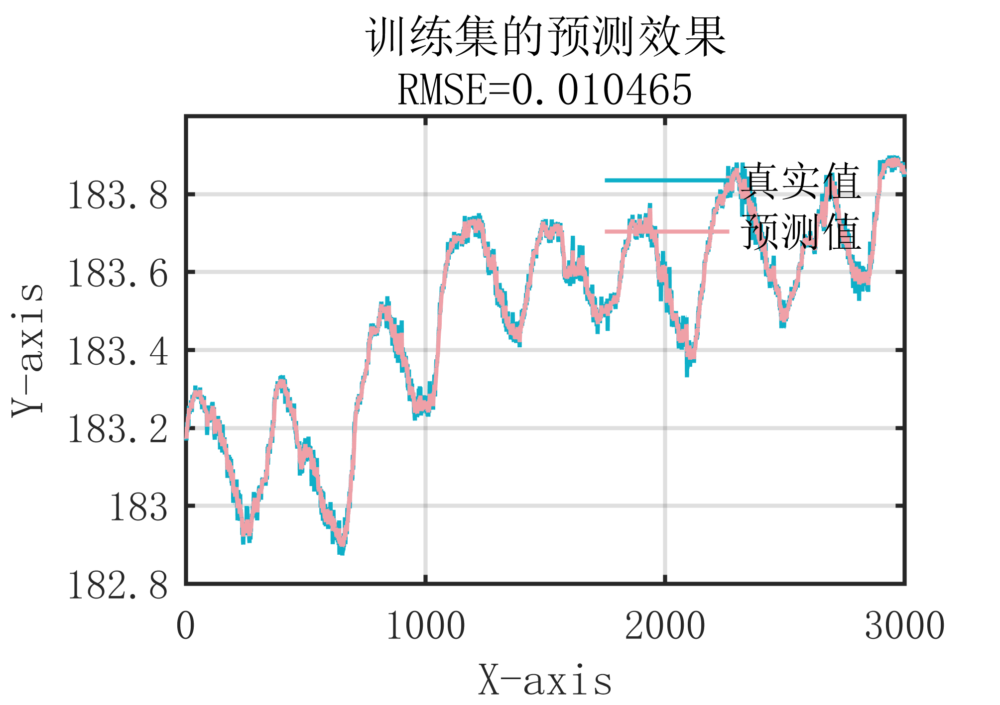
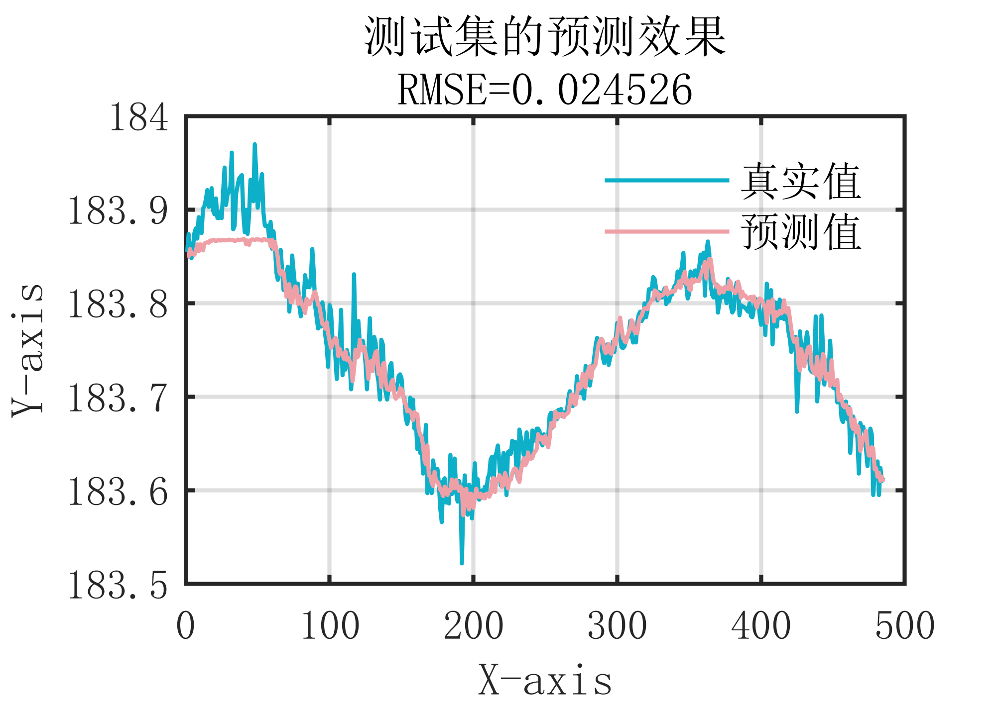
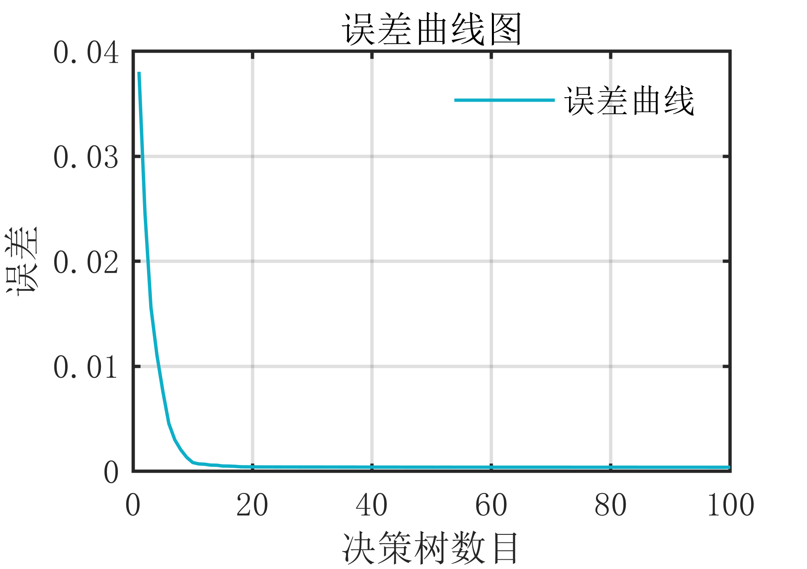
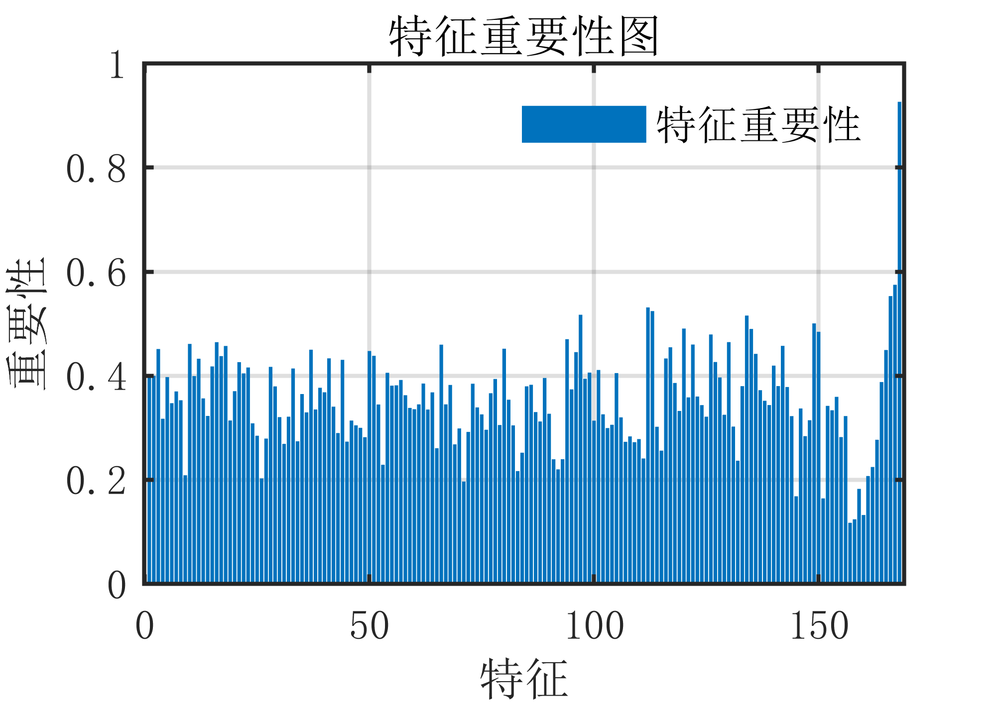

# MATLAB | Time Series Forecasting | Random Forest Algorithm | Included data and plotting code | Directly Useable

1. Basic Definition
Random Forest Time Series Prediction Algorithm is a time series prediction method based on Random Forest. Its basic idea is to use multiple decision trees to predict the time series data, where each decision tree uses a different random sampling method to select the training data to reduce the risk of overfitting. The main steps of the Random Forest Time Series Prediction Algorithm are as follows:
1. Sample Sampling: Randomly select a portion of samples from the original data for training each decision tree.
2. Feature Sampling: Randomly select a subset of features from the original features for training each decision tree.
3. Decision Tree Training: Use the sampled samples and features to construct multiple decision trees, where each tree is an independent classifier.
4. Prediction: For new input data, use the constructed decision trees for prediction, and finally output the average prediction value of each decision tree as the final prediction value.
The Random Forest Time Series Prediction Algorithm has the following advantages:
5. It can handle large-scale, high-dimensional data.
6. It has high accuracy and stability, performing well in dealing with noise and missing values.
7. It can effectively process nonlinear data and complex models.
8. It can perform feature selection to improve the generalization ability of the model. In summary, the Random Forest Time Series Prediction Algorithm is an effective time series prediction method that can be used in various fields such as finance, medical, meteorology, etc., with broad application prospects.
2 Outcome Effect
The attached outcome effect is as follows:
\n        \n      \n        \n      \n        \n      \n        \n      Attach video tutorial operation:
\n        \n          \n          \n          \n          \n            To view this video please enable JavaScript, and consider upgrading to a\n            web browser that\n            supports HTML5 video\n  

## Images

<!-- PAYMENT_BLOCK -->

## Get this dataset

- Payment link (Stripe): [Buy now](https://buy.stripe.com/3cs8yP7sY87d0vu9AB)
- Payment QR code: 

<!-- /PAYMENT_BLOCK -->
